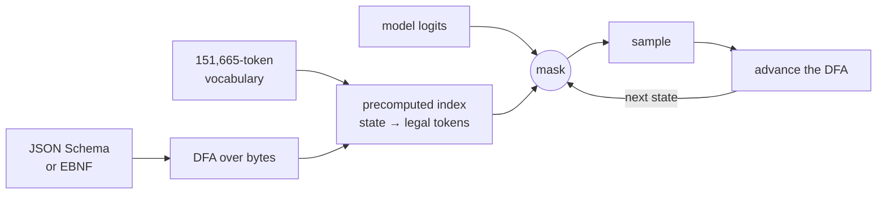

<p align="center">
  
</p>

<p align="center">
  <b>Asking a model for JSON and retrying on failure is a prompt. This is a proof.</b><br>
  <sub>An LLM inference engine written from scratch in Rust, with decoding constrained by a grammar. Malformed output is not unlikely. It is impossible.</sub>
</p>

<p align="center">
  <sub>
    <a href="#overview">OVERVIEW</a> &nbsp;·&nbsp;
    <a href="#quick-start">QUICK START</a> &nbsp;·&nbsp;
    <a href="#how-it-works">HOW IT WORKS</a> &nbsp;·&nbsp;
    <a href="#every-stage-has-an-oracle">ORACLES</a> &nbsp;·&nbsp;
    <a href="#results">RESULTS</a> &nbsp;·&nbsp;
    <a href="#status">STATUS</a>
  </sub>
</p>

<br>

<table>
  <tr>
    <td><sub>NOT USED</sub><br><b>PyTorch · transformers · llama.cpp · ONNX</b></td>
    <td><sub>MODEL</sub><br><b>Qwen2.5-0.5B-Instruct</b></td>
    <td><sub>VALID JSON</sub><br><b>500 / 500</b></td>
    <td><sub>LOGIT PARITY</sub><br><b>1.48e-6</b></td>
  </tr>
</table>

## Overview

Foundry has two halves.

**The engine.** Weights are read straight from `safetensors`. Tokenisation, the Qwen2 forward pass (RMSNorm, rotary embeddings, grouped-query attention with a KV cache, a SwiGLU MLP), sampling and int8 quantisation are all written by hand. The only dependencies are for file I/O and JSON parsing.

**Constrained decoding.** A grammar is compiled into a state machine, and every logit that could break it is masked before sampling. This is the half that matters.

## Quick start

The model files (about 1 GB) go in `models/qwen2.5-0.5b/`. [`docs/MODEL.md`](docs/MODEL.md) says where to get them.

```bash
cargo test --release                              # 95 tests

cargo run --release -p cli -- --chat --prompt "Give me a person: name, age, city." \
  --schema '{"type":"object","properties":{"name":{"type":"string","maxLength":16},"age":{"type":"integer"},"city":{"type":"string","maxLength":16}}}'
```

> [!TIP]
> No checkpoint? The constrained decoder runs on its own: `cargo test -p grammar`, or `cargo run -p grammar --bin demo -- --tokenizer path/to/tokenizer.json`.

## How it works



1. The grammar compiles into a deterministic automaton over **bytes**.
2. That automaton is intersected with the tokenizer's vocabulary ahead of time, giving, for every state, the set of tokens that keep the output on a path to a valid parse.
3. At each decoding step, every other logit is masked out.

The model never gets the chance to be wrong.

> [!IMPORTANT]
> **Why bytes, not characters.** The tokenizer is byte-level BPE, so a character like `é` or `₹` is routinely split across two or three tokens, and a token's bytes are often not valid UTF-8 on their own. A DFA that steps on characters cannot even ask whether such a token is legal. One that steps on bytes always can.

## Every stage has an oracle

There is no stage where "it looks about right" is accepted.

| Stage | What says you are wrong |
|---|---|
| Forward pass | Logits must match the HuggingFace reference |
| Each layer | Activations must match reference dumps |
| Tokenizer | ID parity against `tokenizer.json` |
| KV cache | Incremental decode must be bit-identical to a fresh pass |
| Quantisation | Perplexity delta on held-out text |
| Constrained decoding | 100% of generations must parse. Not 99%. |

Python appears in exactly one place, `scripts/`, which dumps reference activations *from* HuggingFace so the engine can be checked *against* them. It never touches the inference path.

## Results

Apple M5, 10 cores, 16 GB. Ten timed runs after three warm-ups, 512-token prompt, 128 generated tokens. Methodology in [`docs/BENCHMARKS.md`](docs/BENCHMARKS.md).

| Metric | f32 | int8 |
|---|---|---|
| Logit parity vs. HuggingFace | **1.48e-6** | |
| Tokenizer ID parity | **42 / 42** | |
| Constrained outputs that parse | **500 / 500** | |
| Prefill (tok/s) | 20.61 | 17.12 |
| Decode (tok/s) | 10.36 | 11.78 |
| Weights in memory | 1,884.6 MB | **473.1 MB** (3.98× smaller) |
| Perplexity change | | **+0.10%** |
| llama.cpp comparison | not run | left empty rather than guessed |

<details>
<summary><b>Why int8 is slower to prefill but faster to decode</b></summary>
<br>

Dequantising on the fly adds a cast per element, which dominates prefill's large matrix multiplies. During decode, one token at a time, the smaller footprint wins on cache locality instead. "int8 is faster" is only true if you say which phase.

</details>

<details>
<summary><b>Why the perplexity sample is 767 tokens, not 256</b></summary>
<br>

At 256 tokens the change read −0.17%, which would mean int8 beat f32. At 512 it read +0.11%, at 768 +0.10%. Below about 768 tokens even the sign is noise. The corpus is committed, so the result reproduces offline.

</details>

<details>
<summary><b>Six real defects, found by hunting for them</b></summary>
<br>

A systematic bug hunt across all five crates found a reachable panic and a one-line JSON Schema that could stall the process for minutes, among six fixes. Each is written up in [`docs/DECISIONS.md`](docs/DECISIONS.md).

</details>

## Status

The engine, grammar compiler and constrained generation work end to end on the real checkpoint, clippy clean. Still to do: the llama.cpp comparison, a measured masking overhead, and the long-form writeup.

Every module was also gated on understanding: explained before it was written and defended closed-book afterwards. The record is in [`docs/QUIZ_LOG.md`](docs/QUIZ_LOG.md).

<details>
<summary><b>Layout and documents</b></summary>
<br>

```
crates/tensor      hand-written tensor ops, SIMD, quantisation
crates/tokenizer   byte-level BPE
crates/model       the Qwen2 forward pass, KV cache, sampling
crates/grammar     schema → DFA → vocabulary index → mask
crates/cli         the binary, parity and perplexity tools
scripts/           reference dumps and benchmarks
```

[Architecture](docs/ARCHITECTURE.md) · [Model](docs/MODEL.md) · [Grammar](docs/GRAMMAR.md) · [Testing](docs/TESTING.md) · [Benchmarks](docs/BENCHMARKS.md) · [Decisions](docs/DECISIONS.md) · [Glossary](docs/GLOSSARY.md) · [Roadmap](docs/ROADMAP.md)

</details>

<sub>MIT.</sub>
