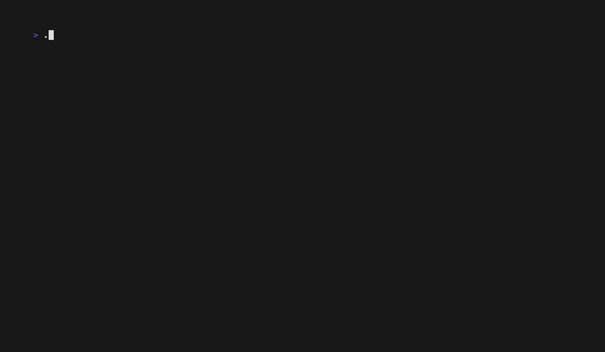
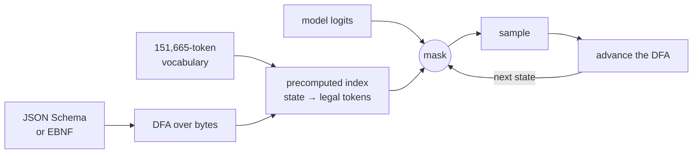

<p align="center">
  
</p>

<p align="center">
  <b>Asking a model for JSON and retrying on failure is a prompt. This is a proof.</b><br>
  <sub>An LLM inference engine written from scratch in Rust, with decoding constrained by a grammar. Malformed output is not unlikely. It is impossible.</sub>
</p>

<p align="center">
  <sub>
    <a href="#overview">OVERVIEW</a> &nbsp;·&nbsp;
    <a href="#quick-start">QUICK START</a> &nbsp;·&nbsp;
    <a href="#how-it-works">HOW IT WORKS</a> &nbsp;·&nbsp;
    <a href="#every-stage-has-an-oracle">ORACLES</a> &nbsp;·&nbsp;
    <a href="#results">RESULTS</a> &nbsp;·&nbsp;
    <a href="#status">STATUS</a>
  </sub>
</p>

<br>

<table>
  <tr>
    <td><sub>NOT USED</sub><br><b>PyTorch · transformers · ONNX · BLAS</b></td>
    <td><sub>MODEL</sub><br><b>Qwen2.5-0.5B-Instruct</b></td>
    <td><sub>VALID JSON</sub><br><b>500 / 500</b> grammar · <b>100 / 100</b> on-model</td>
    <td><sub>LOGIT PARITY</sub><br><b>1.78e-6</b></td>
  </tr>
</table>

<p align="center"></p>

## Overview

Foundry has two halves.

**The engine.** Weights are read straight from `safetensors`. Tokenisation, the Qwen2 forward pass (RMSNorm, rotary embeddings, grouped-query attention with a KV cache, a SwiGLU MLP), sampling and int8 quantisation are all written by hand. The only dependencies are for file I/O and JSON parsing.

**Constrained decoding.** A grammar is compiled into a state machine, and every logit that could break it is masked before sampling. This is the half that matters.

## Quick start

The model files (about 1 GB) go in `models/qwen2.5-0.5b/`. [`docs/MODEL.md`](docs/MODEL.md) says where to get them.

```bash
cargo test --release                              # 103 tests

cargo run --release -p cli -- --chat --prompt "Give me a person: name, age, city." \
  --schema '{"type":"object","properties":{"name":{"type":"string","maxLength":16},"age":{"type":"integer"},"city":{"type":"string","maxLength":16}}}'
```

> [!TIP]
> No checkpoint? The constrained decoder runs on its own: `cargo test -p grammar`, or `cargo run -p grammar --bin demo -- --tokenizer path/to/tokenizer.json`.

## How it works



1. The grammar compiles into a deterministic automaton over **bytes**.
2. That automaton is intersected with the tokenizer's vocabulary ahead of time, giving, for every state, the set of tokens that keep the output on a path to a valid parse.
3. At each decoding step, every other logit is masked out.

The model never gets the chance to be wrong.

> [!IMPORTANT]
> **Why bytes, not characters.** The tokenizer is byte-level BPE, so a character like `é` or `₹` is routinely split across two or three tokens, and a token's bytes are often not valid UTF-8 on their own. A DFA that steps on characters cannot even ask whether such a token is legal. One that steps on bytes always can.

## Every stage has an oracle

There is no stage where "it looks about right" is accepted.

| Stage | What says you are wrong |
|---|---|
| Forward pass | Logits must match the HuggingFace reference |
| Each layer | Activations must match reference dumps |
| Tokenizer | ID parity against `tokenizer.json` |
| KV cache | Incremental decode must be bit-identical to a fresh pass |
| Quantisation | Perplexity delta on held-out text |
| Constrained decoding | 100% of generations must parse. Not 99%. |

Python appears in exactly one place, `scripts/`, which dumps reference activations *from* HuggingFace so the engine can be checked *against* them. It never touches the inference path.

## Results

Apple M5, 10 cores, 16 GB, rustc 1.97.1 `--release`. Ten timed runs after three warm-ups, 512-token prompt, 128 generated tokens, medians. Everything below is printed by [`scripts/bench.sh`](scripts/bench.sh) (plus `perplexity`); methodology in [`docs/BENCHMARKS.md`](docs/BENCHMARKS.md).

| Metric | f32 | int8 |
|---|---|---|
| Logit parity vs. HuggingFace (relative) | **1.78e-6** | |
| Tokenizer ID parity | **42 / 42** | |
| Prefill (tok/s) | 95.8 | 96.2 |
| Decode (tok/s) | 21.0 | 40.8 |
| Weights in memory | 1,884.6 MB | **473.1 MB** (3.98× smaller) |
| Peak RSS | 3,555 MB | 2,387 MB |
| Perplexity change (wikitext-2, 767 tokens) | | **+0.10%** |

**Constrained vs. prompted-only JSON** — same model, same chat prompt (schema included in the text), 100 generations each over four schemas, temperature 0.7, judged by `serde_json` and an independent schema checker (`json_compare`):

| | prompted-only | constrained |
|---|---|---|
| Parses as JSON, strict | 55 / 100 | **100 / 100** |
| Parses after stripping a ``` fence | 98 / 100 | **100 / 100** |
| Conforms to the schema, strict | 37 / 100 | **100 / 100** |
| Conforms after stripping a fence | 76 / 100 | **100 / 100** |
| Cost of the mask (DFA mask + advance) | — | **0.19 ms / token** (≈0.4% of a 47 ms f32 decode step) |

The int8 run gives the same shape (53 / 38 / 100 / 100). Constrained decode tok/s reads slightly *higher* than prompted-only (26.0 vs 23.8) because its outputs are shorter and carry less context, not because masking is free speed — the per-token mask cost above is the honest overhead number.

**Against llama.cpp** (Homebrew build, official Qwen GGUFs, `-ngl 0`, 10 threads; mean ± sd). A reference point, **not a like-for-like race**: its build links Apple's Accelerate BLAS for prompt processing, which this project forbids itself, and Q8_0 uses a scale per 32 weights where this uses one per row.

| | prefill (tok/s) | decode (tok/s) |
|---|---|---|
| llama.cpp F16 | 362 ± 45 | 26.8 ± 2.3 |
| Foundry f32 | 95.8 | 21.0 |
| llama.cpp Q8_0 | 771 ± 45 | 87.2 ± 2.0 |
| Foundry int8 | 96.2 | 40.8 |

Foundry is about 3.8× behind on f32 prefill and 8× behind on int8 prefill, and 1.3× / 2.1× behind on decode. Decode is the fairer comparison (memory- and kernel-bound, no BLAS involved).

<details>
<summary><b>What the SIMD work bought, and what it did not</b></summary>
<br>

Same binary, same harness, `FOUNDRY_SCALAR=1` switching the kernels (the scalar path also has the thread pool and tiling, so this isolates NEON only):

| | scalar | NEON |
|---|---|---|
| f32 prefill | 32.0 | 95.8 |
| f32 decode | 20.3 | 21.0 |
| int8 prefill | 25.5 | 96.2 |
| int8 decode | 13.4 | 40.8 |

f32 decode barely moved: it is bound by streaming ~2 GB of weights per token, so a faster dot product has nothing to speed up. Prefill at 512 tokens now plateaus near 96 tok/s for both precisions, which points away from the matmul; attention is still scalar and O(seq²) (a hypothesis — not profiled). See [explainer 07](docs/explainers/07-matmul-performance.md).

</details>

<details>
<summary><b>Why int8 prefill is no faster but decode is</b></summary>
<br>

Weight-only int8 still multiplies in f32, so every weight is widened and converted first. That cost is hidden when decode is waiting on memory (a quarter of the bytes stream past) and exposed when prefill is compute-bound. "int8 is faster" is only true if you say which phase.

</details>

<details>
<summary><b>Why the perplexity sample is 767 tokens, not 256</b></summary>
<br>

At 256 tokens the change read −0.17%, which would mean int8 beat f32. At 512 it read +0.11%, at 768 +0.10%. Below about 768 tokens even the sign is noise. The corpus is committed, so the result reproduces offline.

</details>

<details>
<summary><b>Six real defects, found by hunting for them</b></summary>
<br>

A systematic bug hunt across all five crates found a reachable panic and a one-line JSON Schema that could stall the process for minutes, among six fixes. Each is written up in [`docs/DECISIONS.md`](docs/DECISIONS.md).

</details>

## Status

Complete for v1: engine, grammar compiler, constrained generation, int8, NEON kernels, typed errors, benchmarks and writeup. Clippy clean, 103 tests. What went wrong along the way, including negative results, is in [`docs/WRITEUP.md`](docs/WRITEUP.md); each module has an interview-style explainer in [`docs/explainers/`](docs/explainers/README.md).

<details>
<summary><b>Layout and documents</b></summary>
<br>

```
crates/tensor      hand-written tensor ops, SIMD, quantisation
crates/tokenizer   byte-level BPE
crates/model       the Qwen2 forward pass, KV cache, sampling
crates/grammar     schema → DFA → vocabulary index → mask
crates/cli         the binary, bench, perplexity and json_compare tools
scripts/           reference dumps and benchmarks
```

[Architecture](docs/ARCHITECTURE.md) · [Model](docs/MODEL.md) · [Grammar](docs/GRAMMAR.md) · [Testing](docs/TESTING.md) · [Benchmarks](docs/BENCHMARKS.md) · [Decisions](docs/DECISIONS.md) · [Rules](docs/RULES.md) · [Glossary](docs/GLOSSARY.md) · [Roadmap](docs/ROADMAP.md) · [Writeup](docs/WRITEUP.md) · [Explainers](docs/explainers/README.md)

</details>
